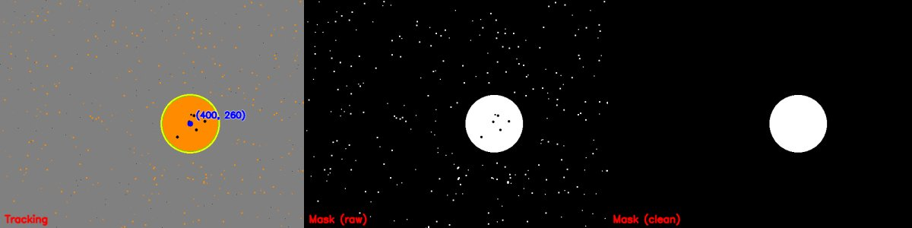
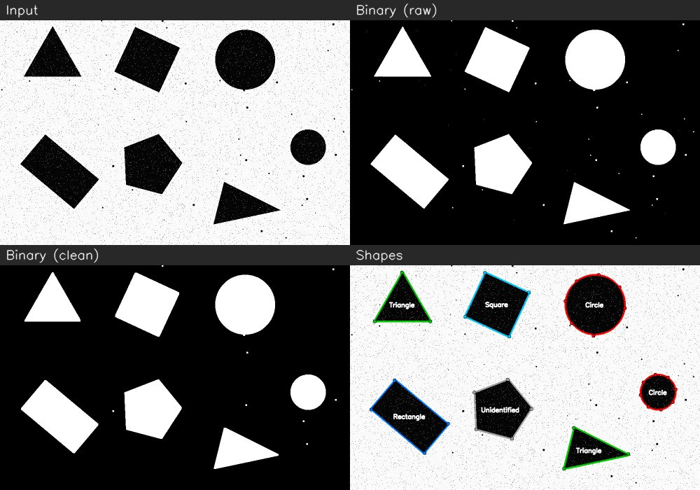
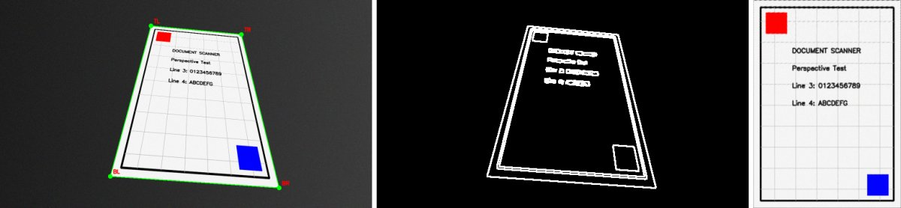
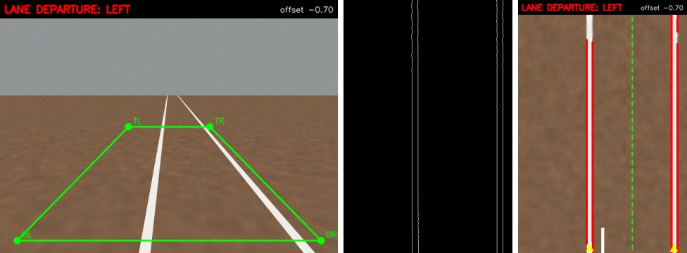
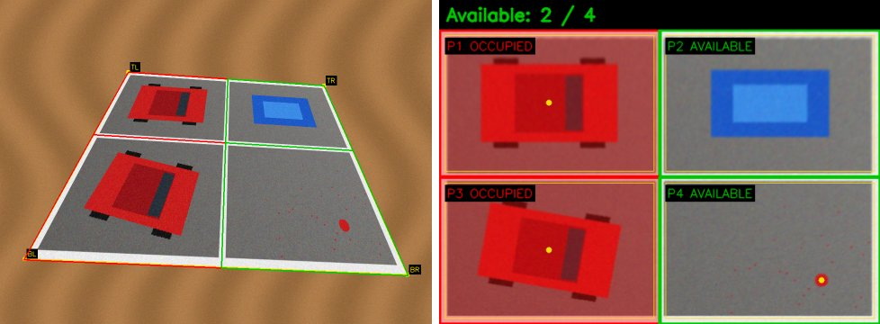
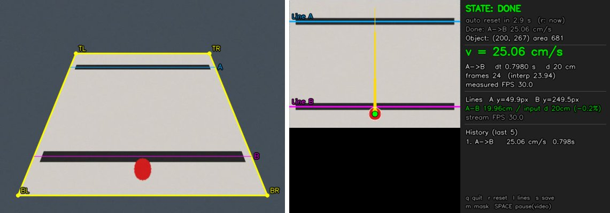
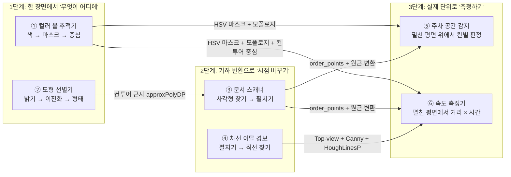

# OpenCV Vision Projects


웹캠 한 대와 책상 위 소품(테이프, 종이, 색 블록, 공)으로 만든 **고전 컴퓨터 비전 프로젝트 6개**입니다.
딥러닝 없이 OpenCV의 기본 연산(색 공간, 이진화, 모폴로지, 컨투어, 원근 변환, 허프 변환)만 조합합니다.
**색 검출 → 형태 분석 → 기하 변환 → 실측(cm, cm/s)** 순서로 단계적으로 확장했습니다.

모든 프로젝트에는 **정답을 아는 합성 데이터를 만들어 CLI를 실제로 돌려 검증하는 자동 테스트**가 있습니다.
웹캠이 없어도 `./run_all_tests.sh` 한 번으로 6개를 모두 확인할 수 있습니다.

---

## 결과 갤러리

| | |
|:---:|:---:|
| **① 컬러 볼 추적기** | **② 도형 선별기** |
|  |  |
| HSV 마스크 → 모폴로지로 점 노이즈와 구멍 제거 → 무게중심 | Otsu 이진화 → 꼭짓점 수 + 원형도로 도형 분류 |
| **③ 문서 스캐너** | **④ 차선 이탈 경보** |
|  |  |
| 사각형 컨투어 검출 → A4 비율로 원근 펼침 | ROI를 Top-view로 → Canny → HoughLinesP → 이탈 판정 |
| **⑤ 주차 공간 감지** | **⑥ 속도 측정기** |
|  |  |
| Top-view에서 칸마다 빨간 차량 점유율 → 디바운스 판정 | Top-view + Hough 기준선 + 공 추적 → 통과 시간으로 cm/s |

> 갤러리 이미지는 각 프로젝트의 자동 테스트가 만든 실제 출력입니다(합성 입력).

---

## 프로젝트 한눈에 보기

| # | 폴더 | 해결하는 문제 | 핵심 기법 | 규모 | 검증 결과 |
|:-:|---|---|---|--:|---|
| ① | [`color_ball_tracker`](color_ball_tracker) | 특정 색 공의 위치 추적 | HSV `inRange`, 열기/닫기, `moments` | 535줄 | 노이즈 덩어리 0개, 중심 오차 **0.0 px** |
| ② | [`shape_classifier`](shape_classifier) | 종이 위 도형 종류와 개수 판별 | Otsu, `approxPolyDP`, 원형도, `minAreaRect` | 736줄 | 도형 7개 **전부 정답** |
| ③ | [`contour_perspective_doc_scanner`](contour_perspective_doc_scanner) | 비스듬히 찍은 A4 용지를 정면으로 펼치기 | 다중 경로 컨투어, 변 검증, `cornerSubPix`, 원근 변환 | 1,036줄 | 어려운 장면 **98%** 검출, 오검출 **0**, 6.7 ms/frame |
| ④ | [`hough_line_perspective_lane`](hough_line_perspective_lane) | 테이프 차선에서 벗어나면 경보 | Top-view, Canny, `HoughLinesP`, 차선 묶기 | 851줄 | 8개 장면 판정 정답, 차선 위치 오차 **< 1 px** |
| ⑤ | [`parking_spot_detector`](parking_spot_detector) | 주차 칸별 점유/빈칸 판정 | Top-view, ROI별 HSV, 점유율, 디바운스 | 1,054줄 | 4칸 **4/4 정답**, Top-view 복원 PSNR 30.5 dB |
| ⑥ | [`speed_meter`](speed_meter) | 물체의 실제 속도(cm/s) 측정 | Top-view 축척, Hough 기준선, 보간, 상태 머신 | 1,224줄 | 3개 속도 오차 **≤ 0.25%** |

*규모는 테스트와 합성 데이터 생성기를 포함한 Python 코드 줄 수입니다. 전체 약 6,000줄.*

---

## 폴더 구성

```
opencv-vision-projects/
├── README.md                          ← 이 문서
├── run_all_tests.sh                   ← 6개 프로젝트 자동 테스트 일괄 실행
├── requirements.txt                   ← 공통 의존성 (opencv-python, numpy)
├── docs/images/                       ← README 갤러리 이미지 (테스트 출력)
│
├── color_ball_tracker/                ① 색 검출 기초
│   ├── color_tracker.py                  추적기 본체 (웹캠 / --image / --no-gui)
│   ├── make_test_image.py                주황 공 + 점 노이즈 + 구멍 합성 이미지와 정답 JSON
│   └── README.md
│
├── shape_classifier/                  ② 형태 분석 기초
│   ├── shape_classifier.py               선별기 본체 + 정답 라벨 비교(evaluate)
│   ├── make_test_image.py                도형 7개 + 노이즈 합성 이미지와 라벨 JSON
│   └── README.md
│
├── contour_perspective_doc_scanner/   ③ 컨투어 + 원근 변환
│   ├── doc_scanner.py                    스캐너 본체
│   ├── make_test_image.py                기울기/원근/음성 케이스 합성 이미지와 꼭짓점 정답
│   ├── test_scanner.py                   기본 자동 테스트
│   ├── stress_test.py                    13개 시나리오 인식률, 오검출, 속도 측정
│   └── README.md
│
├── hough_line_perspective_lane/       ④ 원근 변환 + 허프 변환
│   ├── lane_detector.py                  차선 검출 + 이탈 판정 + ROI 드래그 편집
│   ├── make_test_image.py                알려진 호모그래피로 렌더링한 도로 장면 8종
│   ├── test_lane.py                      CLI + 단위 테스트
│   └── README.md
│
├── parking_spot_detector/             ⑤ 응용: 원근 + 색 + ROI 판정
│   ├── parking.py                        보정(영역/칸) + 실시간 감지
│   ├── make_test_image.py                주차장 합성 이미지 + 설정 + 정답
│   ├── run_test.sh                       생성 → 감지 → 정답 비교
│   └── README.md
│
└── speed_meter/                       ⑥ 응용: 원근 + 허프 + 색 + 시간
    ├── speed_meter.py                    보정 + 실시간 측정 + CSV 기록
    ├── config.json                       측정 영역 보정값 (예시)
    ├── test_speed.py                     정답 속도 합성 동영상 → CLI 측정 → 오차 검증
    └── README.md
```

프로젝트마다 `requirements.txt`가 따로 있어 **폴더 하나만 떼어 가도 독립적으로 실행**됩니다.
프로젝트끼리 서로 import하지 않습니다.
테스트가 만드는 합성 이미지와 결과물(`test_images/`, `test_output/`, `output/` 등)은 매번 다시 만들어지므로 저장소에 넣지 않았습니다.

---

## 프로젝트 간 연관 관계

### 1. 단계별 확장 구조

여섯 프로젝트는 **앞 단계의 기법을 부품으로 다시 쓰는** 3단계 구조입니다.



- **1단계 (①②)**: 영상 한 장에서 관심 영역을 **마스크로 분리**하고 **컨투어로 형태와 위치**를 구합니다.
  - ①은 색(HSV)으로, ②는 밝기(Otsu 이진화)로 분리합니다.
  - 노이즈는 두 프로젝트 모두 블러(1차)와 모폴로지 열기/닫기(2차)로 단계적으로 제거합니다. 이 2단계 노이즈 제거는 ③⑤⑥에서도 그대로 씁니다.
- **2단계 (③④)**: 카메라가 비스듬히 본 평면을 **위나 정면에서 본 시점으로 펴는 것**(Perspective Transform)이 핵심입니다.
  - ③은 변환할 4점을 **영상에서 찾아냅니다**(컨투어 → 사각형).
  - ④는 4점을 **사람이 지정하고**(ROI 드래그), 펴진 평면에서 직선을 찾습니다.
  - 둘 다 "펴면 문제가 쉬워진다"는 같은 아이디어입니다. 문서는 직사각형이 되고, 차선은 세로선이 됩니다.
- **3단계 (⑤⑥)**: 펴진 평면을 **실제 크기가 정해진 좌표계**로 씁니다.
  - ⑤는 Top-view를 칸 단위로 나눠, 칸마다 ①의 색 검출과 점유율 판정을 합니다.
  - ⑥은 Top-view의 1 px를 0.1 cm로 고정해 **픽셀 거리를 cm로 바꿉니다**.
  - ⑥은 ④의 허프 변환으로 기준선을 찾고, ①의 색 검출로 물체를 추적한 뒤 시간 축(보간, 상태 머신)을 더해 속도를 냅니다.

### 2. 기법 × 프로젝트 매트릭스

| 기법 | ① 색 추적 | ② 도형 | ③ 문서 | ④ 차선 | ⑤ 주차 | ⑥ 속도 |
|---|:-:|:-:|:-:|:-:|:-:|:-:|
| GaussianBlur 전처리 | ● | ● | ● | ● | ● | ● |
| HSV 색 검출 (`inRange`) | ● | | | | ● | ● |
| 빨강 Hue 두 구간 OR (0 부근 + 179 부근) | | | | | ● | ● |
| 이진화 (Otsu / 고정) | | ● | ● | | | |
| 모폴로지 열기 / 닫기 | ● | ● | ● | | ● | ● |
| Canny 엣지 | | | ● | ● | | ● |
| 컨투어 + `moments` 중심 | ● | ● | | | ● | ● |
| `approxPolyDP` 다각형 근사 | | ● | ● | | | |
| 4점 정렬 `order_points` (x+y, y−x) | | | ● | | ● | ● |
| Perspective Transform (Top-view) | | | ● | ● | ● | ● |
| 역변환으로 결과를 원본에 다시 그리기 | | | | | ● | ● |
| `HoughLinesP` 직선 검출 + 선분 묶기 | | | | ● | | ● |
| 시간 축 처리 (EMA / 디바운스 / 상태 머신) | | | EMA | | 디바운스 | 상태 머신 + 보간 |
| 마우스 보정 UI | | | | ROI 드래그 | 4점 클릭 + 칸 드래그 | 4점 클릭 |

**같은 문제를 같은 방식으로 푼 예**
- **빨강 검출**: ⑤ `red_mask`와 ⑥ `build_color_mask` 모두 빨강을 Hue 0–10과 170–179 두 구간으로 나눠 `inRange`한 뒤 OR로 합칩니다. OpenCV의 Hue는 0–179 원형이라 빨강이 양 끝에 걸쳐 있기 때문입니다.
- **꼭짓점 정렬**: ③⑤⑥의 `order_points`는 모두 `x+y`가 최소이면 좌상, 최대이면 우하로, `y−x`가 최소이면 우상, 최대이면 좌하로 정렬합니다. 사용자가 꼭짓점을 아무 순서로 클릭하거나 검출해도 변환이 뒤집히지 않습니다.
- **테이프 한 줄 = 엣지 두 줄**: ④와 ⑥ 모두 테이프의 양쪽 경계가 Canny에서 선 2개로 나오는 문제를 만났습니다. 둘 다 가까운 선분을 위치 기준으로 묶어 한 줄로 처리합니다. ④는 화면 아래까지 연장한 x 기준으로, ⑥은 y 기준 길이 가중 평균으로 묶습니다.

### 3. 공통 설계 규칙

여섯 프로젝트는 같은 구조와 사용법을 따르도록 맞췄습니다.

| 규칙 | 내용 |
|---|---|
| **입력 추상화** | 웹캠, 정지 이미지(`--image`), 동영상(④⑥)을 같은 처리 함수에 넣습니다. ⑤⑥은 `FrameSource` 클래스로 감쌌습니다 |
| **헤드리스 모드** | `--no-gui`(⑥은 `--no-display`)로 창 없이 한 번 처리하고 결과 이미지를 파일로 저장합니다. CI나 원격 서버에서도 실행할 수 있습니다 |
| **종료 코드** | ③④는 성공이면 `0`, 미검출이면 `2`, 입력 오류면 `1`입니다. 테스트가 종료 코드로 음성 케이스를 검증합니다 |
| **파이프라인 함수 분리** | `preprocess → detect → (warp) → judge → draw`처럼 단계마다 함수를 나누고, `process_frame`이 중간 결과를 모두 돌려줍니다. 디버그 창과 테스트가 중간 단계를 바로 확인할 수 있습니다 |
| **실시간 튜닝** | 트랙바로 임계값을 바꾸면 다음 프레임에 바로 반영됩니다. 정한 값은 키 한 번으로 저장합니다(① `p` 코드 출력, ④ `o` ROI 저장, ⑤ `p` / ⑥ `s` config 저장) |
| **설정 파일** | 보정값(꼭짓점, 실제 크기, HSV)은 JSON으로 저장합니다. 누락된 항목은 기본값과 병합해서 읽습니다 |
| **합성 데이터 테스트** | `make_test_image.py`가 정답(중심, 꼭짓점, 차선 x, 점유 상태, 속도)을 아는 장면을 만듭니다. 테스트는 실제 CLI를 subprocess로 실행해 출력을 정답과 비교합니다 |
| **화면 표시 언어** | `putText`는 한글을 그리지 못해서 화면에는 영어를, 콘솔에는 한글을 씁니다 |

---

## 빠른 시작

```bash
git clone https://github.com/pth6254/opencv-vision-projects.git
cd opencv-vision-projects

python3 -m venv .venv && source .venv/bin/activate
pip install -r requirements.txt

./run_all_tests.sh             # 6개 프로젝트 자동 테스트 (웹캠 불필요)
./run_all_tests.sh --stress    # + 문서 스캐너 스트레스 테스트
```

웹캠으로 실행하는 방법은 각 폴더의 README를 참고하세요.

```bash
python color_ball_tracker/color_tracker.py
python shape_classifier/shape_classifier.py
python contour_perspective_doc_scanner/doc_scanner.py
python hough_line_perspective_lane/lane_detector.py
python parking_spot_detector/parking.py --calibrate-area      # 보정부터
python speed_meter/speed_meter.py --calibrate                 # 보정부터
```

**확인한 환경**: Ubuntu 24.04 · Python 3.12 · OpenCV 4.6 · NumPy 1.26

## 한계

- 수치는 모두 **합성 데이터 기준**입니다. 합성 데이터에는 노이즈, 블러, JPEG 압축, 가림, 그림자를 넣었지만, 실제 조명과 렌즈 왜곡은 포함하지 않았습니다.
- 고전 기법이라 **조명과 배경에 민감합니다**. 그래서 프로젝트마다 트랙바 튜닝 UI와 README의 "튜닝 포인트" 표를 두었습니다.
- 원근 변환은 대상이 **평면**이라고 가정합니다(책상, 종이, 바닥). 높이가 있는 물체는 Top-view에서 늘어나 보입니다.

## 라이선스

[MIT License](LICENSE)
