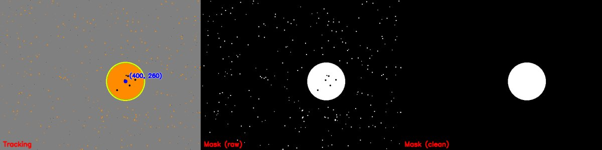

# 컬러 볼 추적기 (HSV + Morphology + Moments)

웹캠 영상에서 특정 색(기본: 주황) 공을 찾아 윤곽선, 외접원, 무게중심 좌표를 실시간으로 표시합니다.



*왼쪽부터: 추적 결과 / HSV 마스크(원본) / 모폴로지로 정리한 마스크. 점 노이즈와 공 안의 구멍이 사라졌습니다.*

## 파이프라인

| 단계 | 처리 | 함수 |
|---|---|---|
| 1. 프레임 입력 | `cv2.VideoCapture` 또는 `--image` 정지 이미지 | `run_camera`, `load_image` |
| 2. 전처리 | `GaussianBlur(5x5)`로 센서 노이즈 감소 | `preprocess` |
| 3. 색상 검출 | BGR → HSV → `cv2.inRange` (기본 H 5–25, S/V ≥ 120) | `detect_color` |
| 4. 노이즈 제거 | 열기(점 노이즈 제거) → 닫기(구멍 메우기), 5x5 타원 커널 | `clean_mask` |
| 5. 컨투어 검출 | `RETR_EXTERNAL` 중 가장 큰 것 1개. 면적 500 px 미만이면 "물체 없음" | `find_largest_contour` |
| 6. 중심점 계산 | `cv2.moments`로 (m10/m00, m01/m00) 계산 | `compute_center` |

## 실행

```bash
pip install -r requirements.txt

python color_tracker.py                    # 웹캠
python color_tracker.py --image test.png   # 정지 이미지 + 트랙바 튜닝
```

| 창 | 내용 |
|---|---|
| Tracking | 원본 + 컨투어(초록), 외접원(노랑), 중심점(파랑), 좌표 |
| Mask (raw) / Mask (clean) | 모폴로지 전과 후의 이진 마스크 |
| Controls | H/S/V 범위, 열기·닫기 반복 횟수, 최소 면적 트랙바 (실시간 반영) |

| 키 | 동작 |
|---|---|
| `q` | 종료 |
| `p` | 현재 트랙바 값을 코드 상단 상수 형식으로 출력 (튜닝 결과를 코드에 바로 붙여 넣기) |
| `s` | 현재 Tracking 화면을 PNG로 저장 |

## 테스트

```bash
python make_test_image.py                  # 주황 공 + 점 노이즈 400개 + 구멍 6개인 합성 이미지와 정답 JSON
python color_tracker.py --image test_image.png --no-gui --expect 400 260
```

- 정리한 마스크의 흰 덩어리가 정확히 1개인지 확인합니다(연결 요소 개수로 셉니다).
- 중심점 오차가 허용 범위(3 px) 이내인지 확인합니다.
- 실제 결과: **덩어리 1개, 중심점 오차 0.000 px**
