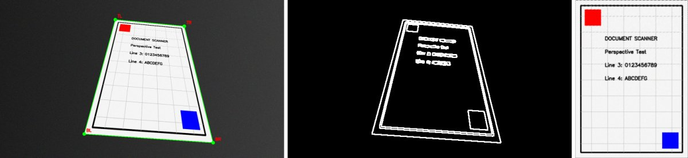

# 문서 스캐너 (Contour + Perspective Transform)

웹캠에 비친 A4 용지(어두운 배경 위 흰 종이)의 외곽선을 실시간으로 찾고,
정면에서 본 것처럼 펼친 결과를 보여주는 OpenCV 스캐너입니다.



*원본 + 검출 사각형 / Canny 엣지 / A4 비율로 펼친 결과 (강한 원근이 걸린 합성 이미지)*

## 설치

Python 3.10 이상이 필요합니다.

```bash
pip install -r requirements.txt
```

## 실행 방법

### 웹캠 모드

```bash
python doc_scanner.py              # 기본 카메라(0번)
python doc_scanner.py --camera 1   # 다른 카메라 사용
```

| 창 | 내용 |
|---|---|
| Original | 원본 영상 + 검출된 사각형(초록 선, 꼭짓점 원, TL/TR/BR/BL 라벨) |
| Edges | Canny 엣지 결과 (튜닝·디버깅용) |
| Warped | 펼친 결과 (420x594, A4 비율). 사각형을 못 찾으면 마지막 성공 결과를 유지 |

| 키 | 동작 |
|---|---|
| `q` | 종료 |
| `s` | 현재 Warped 이미지를 `scans/scan_YYYYmmdd_HHMMSS.png`로 저장 |

카메라를 열지 못하면 에러 메시지를 출력하고 종료합니다(종료 코드 1).

### 정지 이미지 모드

```bash
python doc_scanner.py --image photo.jpg
```

웹캠 대신 이미지 한 장으로 같은 파이프라인을 실행하고 창 3개를 띄웁니다.
`q`로 종료, `s`로 저장합니다.

### GUI 없이 실행 (파일로 저장)

```bash
python doc_scanner.py --image photo.jpg --no-gui --output-dir out
```

`out/` 폴더에 다음 파일이 저장됩니다.

- `photo_original.png`: 검출 결과를 그린 원본
- `photo_edges.png`: 엣지 이미지
- `photo_warped.png`: 펼친 결과 (검출에 성공한 경우만)

종료 코드는 검출 성공 시 `0`, 문서를 찾지 못하면 `2`입니다.

### 테스트

```bash
python make_test_image.py   # 합성 테스트 이미지만 생성 (test_images/)
python test_scanner.py      # 이미지 생성 + 기본 테스트 실행
python stress_test.py       # 어려운 장면에서 인식률·오검출·속도 측정
```

`test_scanner.py`가 확인하는 항목은 다음과 같습니다.

- `order_points`가 무작위 순서의 4점을 좌상, 우상, 우하, 좌하로 정렬하는지
- 기울어진/원근이 걸린 용지 4가지에서 꼭짓점 오차가 6px 미만인지
- 펼친 결과가 정답 이미지와 거의 같은지 (평균 픽셀 차이 20 미만)
- 빨간 마커가 좌상단, 파란 마커가 우하단에 오는지 (뒤집힘·회전 여부)
- 용지가 없거나 너무 작은 이미지에서 크래시 없이 '미검출'로 끝나는지

`stress_test.py`는 실제 웹캠 환경에 가까운 10가지 장면(어수선한 책상, 저대비,
한쪽 조명, 흐림, 노이즈+JPEG, 밝은 물체가 맞닿음, 손가락 가림, 그림자, 멀리 놓인 종이)과
종이가 없는 음성 장면 3가지를 시나리오마다 여러 장 생성해 측정합니다.
설정을 바꿨을 때 인식률이 떨어지지 않았는지 확인하는 용도로 쓰세요.

```bash
python stress_test.py --n 50 --save-fail fails/              # 실패 사례 이미지 저장
python stress_test.py --width 1920 --height 1080             # 해상도 바꿔서 측정
```

1280x720, 시나리오당 50장 기준 측정 결과:

| | 처음 버전 | 현재 버전 |
|---|---|---|
| 양성 검출 성공 | 300/500 (60%) | 491/500 (98%) |
| 음성 오검출 | 0/150 | 0/150 |
| 꼭짓점 평균 오차 | 1.4~2.2px | 0.4~1.0px |
| 처리 시간 | 1.5 ms/frame | 약 6 ms/frame |

## 처리 파이프라인

| 단계 | 함수 | 내용 |
|---|---|---|
| 1. 입력 | `open_camera` | `cv2.VideoCapture(0)` |
| 2. 전처리 | `preprocess` | 그레이스케일 → GaussianBlur(5x5) → Canny → dilate 1회 |
| 3. 컨투어 | `find_document_contour` | 아래 "컨투어 검출 상세" 참고 |
| 4. 꼭짓점 정렬 | `order_points` | x+y 최소=좌상, 최대=우하 / y-x 최소=우상, 최대=좌하 |
| 5. 변환 | `warp_document` | `getPerspectiveTransform` → `warpPerspective` (420x594) |

### 컨투어 검출 상세

`detect_document()`가 2~3단계를 다음 순서로 묶어서 실행합니다.

1. **축소 검출:** 프레임을 폭 640으로 줄여서 검출합니다. 노이즈와 흐림의 영향이 줄어듭니다.
2. **후보 수집:** 세 경로에서 사각형 후보를 모읍니다.
   - Canny를 설정한 임계값으로 1회, 절반·1/4로 낮춰 2회 더 실행합니다 (흐리거나 어두운 영상 대응).
   - 밝기 기반 Otsu 이진화를 1회 실행합니다 (종이 테두리가 주변 선·물체와 엉킨 경우 대응).
3. **컨투어 → 사각형:** 각 경로에서 다음을 거칩니다.
   - `RETR_LIST`로 엣지 고리의 **안쪽 경계**까지 후보로 씁니다. 바깥 윤곽이 다른 물체와 붙어도 안쪽 경계는 종이 모양 그대로 남습니다.
   - `approxPolyDP(0.02*둘레)`로 꼭짓점이 4개가 아니면 볼록 껍질로 오목한 부분을 메우고 다시 근사합니다 (손가락·그림자 대응).
4. **검증:** 다음 조건을 모두 통과한 후보만 남깁니다.
   - 면적이 화면의 10% 이상
   - 네 변의 75% 이상이 실제 엣지 위에 놓임
   - 꼭짓점이 화면 가장자리에 붙어 있지 않음
5. **선택:** 남은 후보 중 가장 큰 사각형을 고릅니다.
6. **꼭짓점 보정:** 원본 해상도에서 `cornerSubPix`로 꼭짓점을 서브픽셀 단위로 다듬습니다.
7. **웹캠 모드 전용:** 프레임 사이의 꼭짓점 떨림을 지수이동평균(EMA)으로 줄입니다.

## 튜닝 포인트

값은 `doc_scanner.py` 위쪽 상수를 고치거나, 실행할 때 옵션으로 바꿀 수 있습니다.
먼저 **Edges 창**을 보고 용지 외곽선이 끊김 없이 닫힌 사각형으로 보이는지 확인하세요.

Edges 창에는 **설정한 임계값으로 만든 Canny 결과**가 나옵니다.
임계값을 낮춘 재시도와 밝기 경로의 결과는 보이지 않습니다.

| 설정 | 기본값 | 옵션 / 상수 | 이럴 때 조정 |
|---|---|---|---|
| Canny 하단·상단 임계값 | 75 / 200 | `--canny-low`, `--canny-high` | 외곽선이 끊기면 **낮추기** (예: 30 / 100). 배경 무늬까지 엣지가 많이 잡히면 **올리기**. 못 찾으면 자동으로 절반·1/4로 낮춰 재시도하므로 기본값으로도 대부분 동작 |
| Canny 재시도 배율 | (1.0, 0.5, 0.25) | `CANNY_RETRY_SCALES` | 재시도를 끄려면 `(1.0,)` |
| 최소 면적 비율 | 0.10 | `--min-area-ratio` | 용지를 멀리 두면 **낮추기** (예: 0.05). 모니터·책 같은 다른 사각형이 잡히면 **올리기** |
| 검출 해상도 | 640 | `--detect-width` | 0이면 원본 크기로 검출. 종이가 화면에 아주 작게 나오면 올리기 (느려짐) |
| 변 검증 비율 | 0.75 | `MIN_SIDE_SUPPORT` | 엉뚱한 사각형이 잡히면 **올리기** (0.85). 손가락 등으로 테두리가 많이 가려져 못 찾으면 **낮추기** (0.6) |
| 밝기(Otsu) 경로 | 켜짐 | `USE_THRESHOLD_PATH` | 배경이 밝거나(흰 책상) 종이와 밝기가 비슷하면 끄기 |
| 웹캠 떨림 보정 | 0.5 | `--smooth` | 꼭짓점이 떨리면 **낮추기** (0.3). 종이를 움직일 때 따라오는 게 느리면 **올리기**. 1.0이면 보정 끔 |
| 다각형 근사 오차 | 0.02 | `APPROX_EPS_RATIO` | 종이가 휘어서 꼭짓점이 5~6개로 나오면 **0.03~0.04로 올리기** |
| dilate 반복 횟수 | 1 | `preprocess()`의 `iterations` | 엣지가 계속 끊기면 **2로 올리기** |
| 순회할 컨투어 수 | 10 | `TOP_N_CONTOURS` | 큰 물체가 많은 장면이면 늘리기 (`RETR_LIST`는 테두리 하나당 컨투어가 2개라서 5x2) |

값을 바꾼 뒤에는 `python stress_test.py`로 인식률과 오검출이 나빠지지 않았는지 확인하세요.

예시:

```bash
# 어두운 조명에서 외곽선이 잘 안 잡힐 때
python doc_scanner.py --canny-low 30 --canny-high 100

# 용지를 멀리 두고 찍을 때
python doc_scanner.py --min-area-ratio 0.05
```

### 잘 인식되게 찍는 요령

- 배경은 어둡고 무늬가 적은 곳이 좋습니다 (종이와의 대비가 클수록 유리).
- 용지의 네 모서리가 모두 화면 안에 들어와야 합니다.
- 그림자나 손가락이 종이 테두리를 가리면 꼭짓점이 4개로 근사되지 않을 수 있습니다.

### 알려진 한계

- **밝은 물체가 종이에 맞닿은 경우** (흰 키보드, 다른 종이 등): 스트레스 테스트에서 50장 중 45장만 성공했습니다. 종이와 물체 사이 경계가 약하면 하나의 덩어리로 보입니다. 물체를 조금 떼어 놓으세요.
- **배경이 밝은 경우** (흰 책상): 이 스캐너는 "어두운 배경 위 흰 종이"를 전제로 합니다. 밝은 배경에서는 `USE_THRESHOLD_PATH = False`로 두고 Canny 경로만 쓰는 편이 낫습니다.
- **종이 일부가 화면 밖으로 나간 경우:** 꼭짓점 4개가 모두 보여야 검출됩니다.
- **실제 웹캠 영상으로는 검증하지 않았습니다.** 수치는 모두 합성 이미지 기준입니다. 실제 환경에서 잘 안 되는 장면이 있으면 그 장면을 사진으로 찍어 `--image --no-gui`로 돌려 보고, 저장된 `_edges.png`를 확인하세요.

## 파일 구성

| 파일 | 설명 |
|---|---|
| `doc_scanner.py` | 스캐너 본체 |
| `make_test_image.py` | 합성 테스트 이미지 생성기 |
| `test_scanner.py` | 기본 자동 테스트 |
| `stress_test.py` | 어려운 장면 인식률·오검출·속도 측정 |
| `requirements.txt` | 의존성 (`opencv-python`, `numpy`) |
