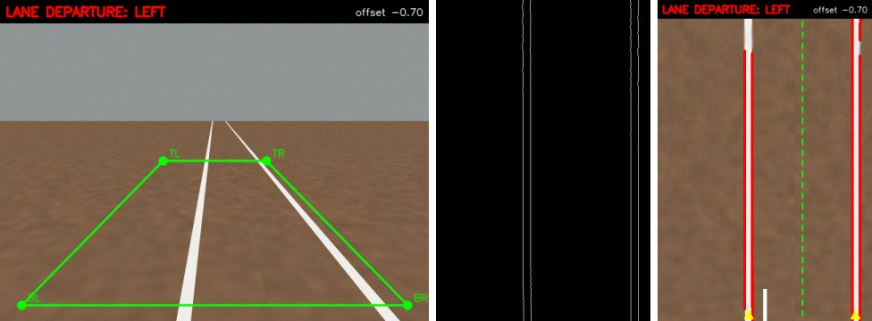

# 가상 차선 이탈 경보 (Hough Line + Perspective)

책상 위에 나란히 붙인 테이프 두 줄을 '도로'로 보고, 카메라 영상의 ROI를
**위에서 내려다본 시점(Top-view)** 으로 바꾼 뒤 **Canny → HoughLinesP** 로 직선을 찾아
**Top-view 영상 위에 붉은색으로** 그리는 프로그램입니다.
여기에 더해, 찾은 직선을 좌/우 차선으로 묶어 차량(화면 중앙)이 한쪽으로 치우치면
`LANE DEPARTURE` 경보를 띄웁니다.



*원본 + ROI / Top-view Canny / Top-view + 검출 직선(빨강), 차량이 왼쪽 차선에 붙어 LEFT 경보*

## 요구사항 대응

| 요구사항 | 구현 위치 |
|---|---|
| ROI 설정 + Perspective Transform (Top-view) | `get_transform`, `warp_to_topview`: `cv2.getPerspectiveTransform` → `cv2.warpPerspective` (400x600) |
| Top-view에서 Canny Edge | `detect_edges`: 그레이스케일 → GaussianBlur(5x5) → `cv2.Canny(50, 150)` |
| HoughLinesP 직선 검출 | `detect_lines`: `cv2.HoughLinesP(edges, 1, π/180, 50, minLineLength=50, maxLineGap=10)` |
| Top-view 위에 붉은색으로 그리기 | `draw_lines` / `draw_topview`: `(0, 0, 255)`, 두께 3. 원본 영상에는 ROI만 그림 |
| (추가) 차선 이탈 경보 | `group_lanes`, `assess_departure` |

## 설치

```bash
pip install -r requirements.txt
```

## 실행 방법

### 웹캠 모드

```bash
python lane_detector.py              # 기본 카메라(0번)
python lane_detector.py --camera 1   # 다른 카메라
python lane_detector.py --video road.avi      # 동영상 파일 (끝나면 반복)
```

| 창 | 내용 |
|---|---|
| Original (ROI) | 원본 영상 + ROI 사다리꼴(초록), 꼭짓점 TL/TR/BR/BL |
| Top-view Edges | Top-view에 Canny를 적용한 결과 |
| Top-view Lanes | Top-view + **검출 직선(빨강)**, 판정에 쓴 차선 위치(노란 삼각형), 차선 중앙(초록 점선), 차량 위치(흰 막대), 상태 배너 |
| Controls | Canny low/high, Hough threshold, minLineLength, maxLineGap 트랙바 (실시간 반영) |

| 조작 | 동작 |
|---|---|
| 마우스 드래그 | Original 창에서 ROI 꼭짓점(초록 원)을 끌어 옮기기 |
| `q` | 종료 |
| `s` | 현재 세 화면을 `captures/` 폴더에 PNG로 저장 |
| `r` | ROI를 기본값으로 되돌리기 |
| `o` | 현재 ROI를 `roi.json`으로 저장 |

### 책상 세팅 순서

1. 책상에 테이프 두 줄을 10~15cm 간격으로 나란히 붙입니다 (책상과 색 대비가 클수록 좋음).
2. 카메라를 테이프 사이 중앙, 낮은 높이에서 테이프 방향을 비스듬히 내려다보게 둡니다.
3. **ROI 꼭짓점을 드래그**해서 사다리꼴의 왼쪽/오른쪽 변이 테이프와 **나란해지게** 맞춥니다.
   Top-view 창에서 두 테이프가 **세로로 곧게, 평행하게** 보이면 맞은 것입니다.
4. `o`를 눌러 저장해 두면 다음부터는 `python lane_detector.py --roi roi.json`으로 바로 시작합니다.
5. 카메라(또는 테이프 붙은 종이)를 좌우로 움직여 보면 차선 쪽으로 치우칠 때 경보가 뜹니다.

### 정지 이미지 / GUI 없이 실행

```bash
python lane_detector.py --image desk.png                       # 창 띄우기 (드래그·트랙바 가능)
python lane_detector.py --image desk.png --no-gui --output-dir out
python lane_detector.py --image desk.png --src "243,240,397,240,608,456,32,456"   # ROI 직접 지정
```

`--no-gui`는 `out/` 폴더에 `*_original.png`, `*_edges.png`, `*_topview.png`를 저장하고
검출 결과(선분 수, 차선 x, 상태, offset)를 출력합니다.
종료 코드는 직선을 하나 이상 찾으면 `0`, 못 찾으면 `2`, 입력을 열 수 없으면 `1`입니다.

## 이탈 판정 방식

Top-view에서는 도로가 세로로 펴지므로 차선은 거의 세로선이 됩니다.

1. 세로에서 25° 넘게 기운 선분(가로로 놓인 펜 같은 것)은 차선 후보에서 뺍니다.
2. 남은 선분을 화면 **맨 아래(차량 위치)까지 연장한 x 좌표**로 정렬하고, 40px 이내끼리 묶습니다.
   테이프 한 줄은 양쪽 경계에서 엣지가 2개 나오기 때문입니다.
3. 차량(화면 아래 중앙)을 사이에 둔 좌/우 차선 한 쌍을 고르고
   `offset = (차량 x − 차선 중앙) / (차선 폭 / 2)` 를 계산합니다.
   - `offset < −0.5` → `LANE DEPARTURE: LEFT` (왼쪽 차선에 붙음)
   - `offset > +0.5` → `LANE DEPARTURE: RIGHT`
   - 그 외 → `LANE OK`
4. 차선이 하나만 보이면, 차량 바로 밑(폭의 15% 이내)에 있을 때만 '선을 밟음'으로 경보하고
   나머지는 `ONE LANE ONLY`로 표시합니다.

경보 중에는 화면 테두리가 빨갛게 깜박입니다.

## 튜닝 포인트

먼저 **Top-view Edges 창**에서 테이프 경계가 세로선 두 쌍으로 깔끔하게 보이는지 확인하세요.

| 설정 | 기본값 | 옵션 / 상수 | 이럴 때 조정 |
|---|---|---|---|
| Canny 하단·상단 | 50 / 150 | 트랙바, `--canny-low/high` | 테이프 경계가 끊기면 **낮추기**, 책상 무늬가 잡히면 **올리기** |
| Hough threshold | 50 | 트랙바, `--hough-threshold` | 직선이 안 나오면 **낮추기**, 잡선이 많으면 **올리기** |
| minLineLength | 50 | 트랙바, `--min-line-length` | 짧은 잡선을 없애려면 **올리기** |
| maxLineGap | 10 | 트랙바, `--max-line-gap` | 점선 차선이나 끊긴 테이프를 한 선으로 이으려면 **올리기** |
| 기본 ROI | 화면 비율 | `DEFAULT_SRC_RATIOS` | 카메라 높이·각도에 맞게 |
| 차선 기울기 허용 | 25° | `MAX_ANGLE_FROM_VERTICAL` | ROI가 덜 맞아 차선이 비스듬하면 늘리기 |
| 경보 기준 | 0.5 | `DEPARTURE_RATIO` | 더 일찍 경보하려면 낮추기 |

### 알려진 한계

- 차량 위치를 'Top-view 화면 아래 중앙'으로 가정합니다. 카메라가 차량 중앙에 있지 않으면
  ROI를 좌우 대칭이 아니게 잡아 보정해야 합니다.
- 차선 근처에 세로 방향의 다른 물체(포스트잇 테두리 등)가 있으면 차선 후보가 하나 더 생길 수 있습니다.
  판정은 차량을 감싸는 가장 가까운 쌍을 쓰므로 대부분 영향이 없지만, 차선 바로 안쪽에 있으면 틀릴 수 있습니다.
- 프레임 간 평활화가 없어 실제 웹캠에서는 경계값 근처에서 경보가 깜박일 수 있습니다.

## 테스트

```bash
python make_test_image.py   # 합성 이미지만 생성 (test_images/)
python test_lane.py         # 이미지 생성 + 전체 테스트 실행 (결과 이미지는 test_output/)
```

합성 이미지는 Top-view 좌표를 책상 평면 좌표로 두고, 알고 있는 호모그래피로 카메라 시점을 렌더링해 만듭니다.
그래서 Top-view에서 차선이 나와야 할 x 위치를 정확히 알 수 있습니다.

| 케이스 | 장면 | 기대 판정 |
|---|---|---|
| center | 차선 중앙 주행 | OK |
| drift_left / drift_right | 한쪽 차선으로 치우침 | LEFT / RIGHT |
| on_line | 선 하나를 밟고 있음 | RIGHT |
| one_lane | 먼 쪽 차선 하나만 보임 | ONE_LANE |
| no_lane | 테이프 없음 | NO_LANE (종료 코드 2) |
| noisy | 노이즈·조명 그라데이션·가로 펜·포스트잇 | OK |
| custom_roi | 비뚤어진 카메라 + `--src` 지정 | OK |

검증 항목: ROI 4점 → Top-view 모서리 매핑, 차선 x 위치 오차 6px 미만, 판정 결과,
Top-view 결과에 붉은 직선 픽셀 존재, 이탈 판정 단위 테스트, 올바른 `--src`가 기본 ROI보다 정확한지.

## 파일 구성

| 파일 | 설명 |
|---|---|
| `lane_detector.py` | 본체 (웹캠/동영상/이미지 모드) |
| `make_test_image.py` | 합성 테스트 이미지 생성기 |
| `test_lane.py` | 자동 테스트 |
| `requirements.txt` | 의존성 (`opencv-python`, `numpy`) |
