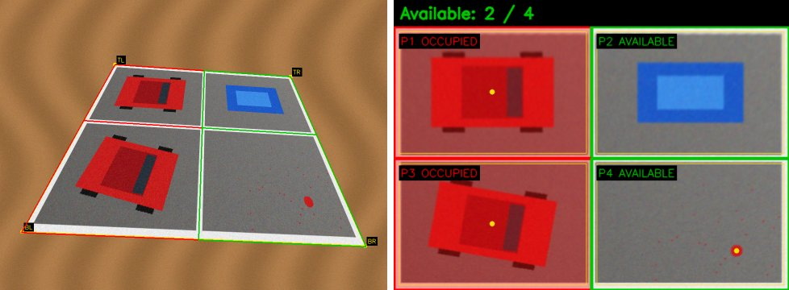

# 주차 공간 감지 (OpenCV)

웹캠으로 비스듬히 찍은 책상 위 주차장을 Top-view로 펴고, 각 칸의 빨간 블록(차량) 유무로
`OCCUPIED` / `AVAILABLE`을 판정합니다.

```bash
pip install -r requirements.txt
```



*카메라 시점(칸 경계를 역변환해 표시) / Top-view 판정. 파란 물체(P2)와 작은 빨간 점(P4)은 빈 칸으로 판정*

## 사용 순서
1. **주차장 보정** – `python parking.py --calibrate-area`
   꼭짓점 4개를 좌상→우상→우하→좌하 순으로 클릭 (순서가 틀려도 자동 정렬). `r` 다시 찍기, `Enter` 저장
2. **칸 보정** – `python parking.py --calibrate-spots`
   Top-view에서 칸을 드래그 (id 자동 부여). `u` 마지막 취소, `Enter` 저장
   또는 `python parking.py --calibrate-spots --grid 2x2` (열x행 균등 분할)
3. **실행** – `python parking.py`
   `q` 종료 · `s` 스크린샷(screenshots/) · `p` 현재 트랙바 값을 config.json에 저장

공통 옵션: `--image 경로`(정지 이미지), `--config 경로`, `--camera N`, `--no-gui`

## 튜닝 순서
1. **HSV** – Masks 창을 보며 `S min`, `V min`을 조절해 차량만 하얗게, 바닥/테이프/그림자는 검게.
   주황·분홍이 섞이면 `H1 max`를 낮추고 `H2 min`을 올린다.
2. **판정 비율** – 빈 칸의 % 와 차량 칸의 % 사이 중간값으로 `Ratio %` 설정 (기본 15%).
   점 노이즈가 남으면 `Kernel`을 키운다.
3. **디바운스** – 손이 지나갈 때 깜빡이면 `Debounce`를 올린다 (30fps 기준 10 ≈ 0.3초).

## 테스트
```bash
./run_test.sh
```
`make_test_image.py`가 합성 이미지(P1·P3 빨간 차, P2 파란 물체, P4 빈 칸 + 작은 빨간 점)를 만들고,
`parking.py --no-gui --expected`가 Top-view 복원 오차와 4칸 판정을 정답과 비교합니다.
결과 이미지는 `test_output/`에 저장됩니다.
