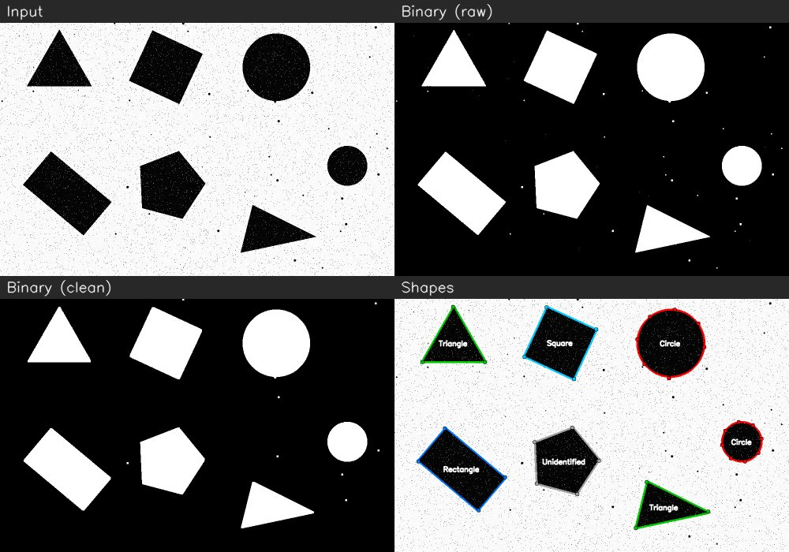

# 도형 선별기 (Threshold + Morphology + approxPolyDP)

흰 종이 위의 검은 도형을 노이즈를 걸러 모두 검출합니다.
**삼각형 / 사각형 / 정사각형 / 원**으로 분류해 중심에 이름을 쓰고, 종류별 개수를 셉니다.



*입력(점 노이즈 포함) → 이진화 → 모폴로지 → 분류 결과. 오각형은 일부러 "Unidentified"로 남겼습니다.*

## 파이프라인

| 단계 | 처리 | 함수 |
|---|---|---|
| 1. 프레임 입력 | 웹캠 또는 `--image` | `open_camera`, `load_image` |
| 2. 1차 노이즈 제거 | 그레이스케일 → `GaussianBlur(5x5)` | `preprocess` |
| 3. 이진화 | **Otsu**(기본) 또는 고정 임계값. `THRESH_BINARY_INV`로 도형을 흰색으로 | `binarize` |
| 4. 2차 노이즈 제거 | 열기(점 제거) → 닫기(끊김, 구멍 메우기) | `clean_binary` |
| 5. 컨투어 필터 | 최소 면적 미만 제외, 화면 테두리에 닿은 컨투어 제외 | `find_shape_contours`, `touches_border` |
| 6. 도형 판별 | 꼭짓점 수 + 원형도 + 회전 보정 종횡비 | `classify_shape` |
| 7. 중심점 | `cv2.moments` | `compute_center` |

## 분류 규칙

```
꼭짓점 수 = len(approxPolyDP(cnt, ε × 둘레))     원형도 = 4π·면적 / 둘레²
 ├─ 3개                          → Triangle
 ├─ 4개 ─ minAreaRect 비율 0.95–1.05 → Square, 그 외 → Rectangle
 ├─ 5개 이상 & 원형도 > 0.80      → Circle
 └─ 그 외                          → Unidentified
```

- **원형도를 같이 쓰는 이유**: 꼭짓점 수만으로 판별하면 오각형이나 육각형도 원으로 분류됩니다.
- **`minAreaRect`를 쓰는 이유**: `boundingRect`는 40° 회전한 직사각형의 비율을 약 1.05로 재서 정사각형으로 잘못 판단합니다. `minAreaRect`는 회전과 상관없이 실제 변의 비율을 잽니다.

## 실행

```bash
pip install -r requirements.txt

python shape_classifier.py                          # 웹캠
python shape_classifier.py --image test_image.png   # 정지 이미지 + 트랙바
```

트랙바로 이진화 방식(Otsu/고정), 임계값, 커널 크기, 반복 횟수, 최소 면적, ε, 정사각형 구분 여부를 실시간으로 바꿀 수 있습니다.
키는 `q` 종료, `s` 저장, `d` 디버그 표시(꼭짓점 수, 원형도) 전환입니다.

## 테스트

```bash
python make_test_image.py                                  # 도형 7개(오각형 1개 포함) + 노이즈 합성 이미지와 정답 라벨 JSON
python shape_classifier.py --image test_image.png --no-gui # 같은 이름의 .json이 있으면 자동 비교
```

검출 결과를 정답 라벨과 **중심 거리로 매칭**해서 종류가 맞는지 비교합니다.
결과는 `output/`에 저장되며, 원본 / 이진화 / 모폴로지 / 결과를 2x2로 묶은 몽타주도 함께 만듭니다. 실제 결과: **ALL PASS**
