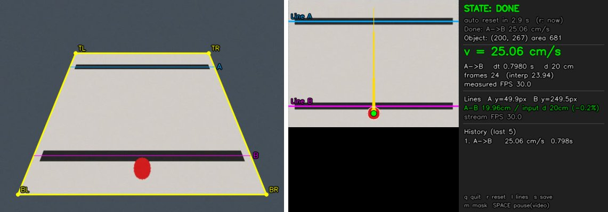

# 실시간 속도 측정기 (Perspective + Hough + HSV + 상태 머신)

책상 위에 테이프로 그은 두 기준선 A, B 사이를 색이 있는 물체(기본: 빨간 공)가 지나가는 시간을 재서 **속도(cm/s)**를 계산합니다.
비스듬히 찍은 카메라 영상을 Top-view로 펴서 **픽셀을 실제 길이(cm)로 환산**하는 것이 핵심입니다.



*왼쪽: 카메라 영상 + 측정 영역(노랑) + 검출 기준선을 역변환해 표시. 오른쪽: Top-view 궤적 + 정보 패널.
합성 영상(정답 25.0 cm/s)에서 **25.06 cm/s**로 측정했고, 기준선 간격은 19.96 cm(입력 20 cm, −0.2%)로 검출했습니다.*

## 파이프라인

| 단계 | 처리 | 코드 |
|---|---|---|
| 1. 프레임 입력 + 타임스탬프 | 웹캠은 `perf_counter`, 동영상은 `프레임 번호 / FPS` | `FrameSource.read` |
| 2. Top-view 변환 | 보정한 4점 → `영역 cm × px_per_cm` 크기 직사각형 (1 px = 0.1 cm) | `build_perspective`, `warp_to_top_view` |
| 3. 기준선 검출 | Canny → `HoughLinesP` → 수평 선분만 → y로 묶기 → 가장 긴 두 묶음 = A, B | `detect_reference_lines` |
| 4. 물체 검출 | HSV 여러 범위를 OR (빨강은 Hue 0 부근과 179 부근) → 가장 큰 컨투어 중심 | `detect_object` |
| 5. 통과 감지 | 이전 점과 현재 점이 선의 반대편에 있는지 + **선형 보간으로 통과 시각 계산** | `find_crossing` |
| 6. 속도 계산 | `v = d / (t2 − t1)` | `SpeedMeasurer._finish` |
| 7. 상태 머신 | WAITING → TRACKING → DONE | `SpeedMeasurer` |

## 정확도를 높인 방법

- **프레임 사이 보간**: 30 fps에서 프레임 간격은 33 ms입니다. 물체가 선을 넘은 두 프레임 사이에서 선형 보간해 통과 시각을 프레임 간격보다 정밀하게 잡습니다.
  `t = t_prev + (t_curr − t_prev) × (line_y − y_prev) / (y_curr − y_prev)`
- **테이프 한 줄의 두 모서리를 하나로 합침**: Canny는 테이프 한 줄에서 위/아래 모서리 두 개를 검출합니다. 이를 y 간격으로 묶어 **길이 가중 평균**을 내고 한 줄로 셉니다. x 구간의 합집합 길이(`_x_coverage`)로 짧은 잡선을 걸러냅니다.
- **방향을 인식하는 상태 머신**
  - 두 선 사이로 **들어오는** 방향으로 통과할 때만 측정을 시작합니다. A를 아래로 넘으면 A→B, B를 위로 넘으면 B→A입니다.
  - 물체가 `max_missing` 프레임 넘게 사라지거나 시작선으로 되돌아가면 측정을 취소합니다.
  - 측정이 끝난 뒤(DONE)에는 3초 후 자동으로 대기 상태로 돌아갑니다.
- **보정 검증**: 검출한 두 선의 간격(cm)을 사용자가 입력한 실제 거리와 비교해 오차 %를 표시합니다. 원근 보정이 틀어졌는지 바로 알 수 있습니다.

## 실행

```bash
pip install -r requirements.txt

python speed_meter.py --calibrate          # 1) 측정 영역 꼭짓점 4개 클릭 + 실제 크기 입력 → config.json
python speed_meter.py                      # 2) 웹캠으로 실시간 측정
python speed_meter.py --source clip.mp4    #    동영상 파일로 측정
python speed_meter.py --color blue         #    HSV 프리셋 (blue / green / red / yellow)
```

| 키 | 동작 |
|---|---|
| `q` / `ESC` | 종료 |
| `r` | 측정 리셋 |
| `l` | 기준선 다시 검출 |
| `s` | 현재 기준선 위치를 `config.json`에 저장 |
| `m` | 마스크 창 표시/숨김 |
| `SPACE` | 일시정지 (동영상만) |

측정 기록은 `speed_log.csv`에 쌓입니다. 시각, 통과 방향, t1/t2, 프레임 차이, 측정 FPS를 함께 기록합니다.

## 테스트

```bash
python test_speed.py
```

정답 속도를 아는 **합성 동영상**을 만들고 실제 CLI(`--no-display --fast`)로 측정해 CSV 값을 검증합니다.

1. Top-view에 테이프 두 줄과 일정 속도로 움직이는 빨간 공을 그립니다.
2. 원근 역변환으로 비스듬히 찍은 카메라 영상처럼 만들고, 센서 노이즈를 더합니다.

| 케이스 | 정답 | 측정 | 오차 | 방향 |
|---|---|---|---|---|
| slow_down | 8.0 cm/s | 8.01 cm/s | 0.18% | A→B |
| fast_down | 25.0 cm/s | 25.06 cm/s | 0.25% | A→B |
| medium_up | 15.0 cm/s | 15.03 cm/s | 0.19% | B→A |

※ OpenCV `putText`는 한글을 그리지 못해서 화면 표시는 영어로, 콘솔 출력은 한글로 했습니다.
